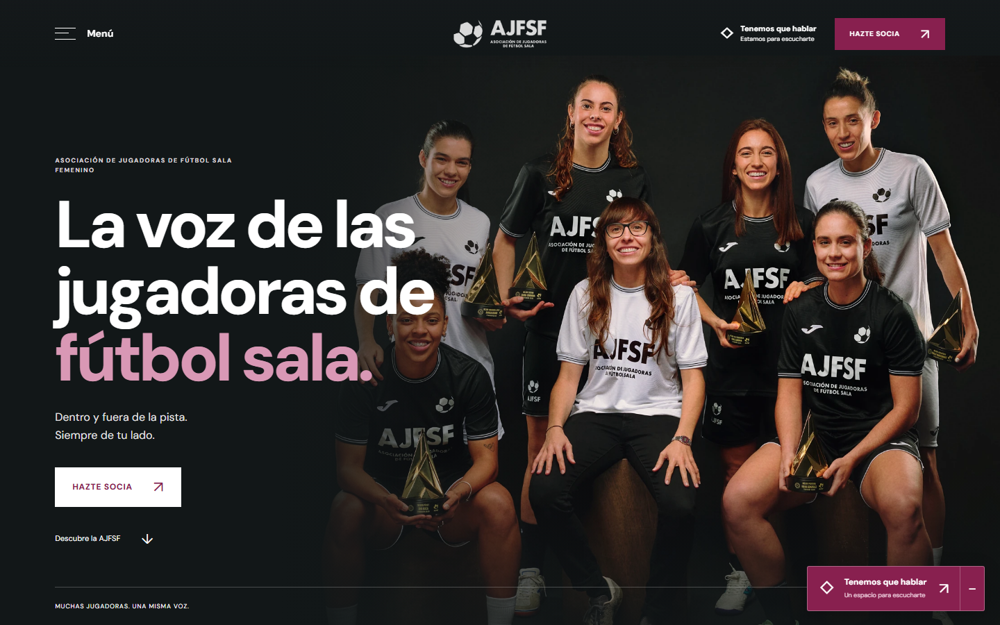
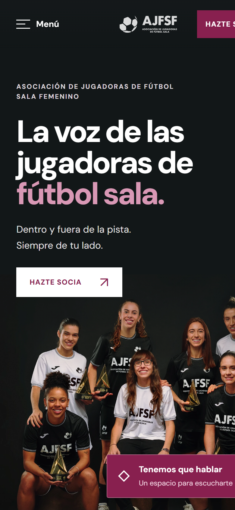
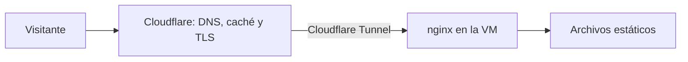

# AJFSF · Sitio web institucional

**Asociación de Jugadoras de Fútbol Sala Femenino** · derechos, formación y una voz colectiva dentro y fuera de la pista.

[Ver el sitio · ajfsf.com](https://ajfsf.com)

     

> **Estado:** publicado desde noviembre de 2026. El código es privado por pedido de la organización; este documento resume el trabajo.

## Mi parte

Desarrollo front-end y **puesta en producción** de la web aprobada por la asociación, de punta a punta: páginas, responsive, SEO básico, empaquetado y despliegue.

## Qué incluye

- Portada con mensaje principal, llamados a la acción y navegación.
- Secciones: qué hacemos, historia, equipo, logros, noticias, informes, ayuda jurídica, contacto y créditos.
- **Mobile first**, con tamaños mínimos de lectura revisados en móvil.
- `sitemap.xml`, `robots.txt` y metadatos para buscadores.
- Identidad de marca propia: ciruela y lima, tipografías Barlow Condensed y DM Sans.

  

## Cómo está publicado

- **Sitio estático** servido por nginx en una VM `e2-micro` de Google Cloud.
- **Cloudflare Tunnel**: la VM no tiene IPv4 pública ni puertos HTTP/HTTPS abiertos; el túnel sale hacia Cloudflare.
- **Acceso administrativo** por SSH a través de IAP, sin exponer el puerto 22.
- **Costo pensado para ser casi nulo**: capa gratuita de Google Cloud y Cloudflare Free.
- **Publicación repetible**: scripts para preparar la versión de producción, empaquetarla, desplegarla y verificarla; para cambios pequeños, un paquete con solo los archivos modificados.

## Lo que aprendí

- Diseñar un despliegue seguro y barato para un sitio institucional.
- Operar una VM sin IP pública y publicar mediante túnel.
- Entregar cambios rápidos sin tocar todo el sitio.

## Autor

**Manuel Dupuy** · [LinkedIn](https://linkedin.com/in/manueldupuy) · [Portfolio](https://angeldupuy.github.io)
